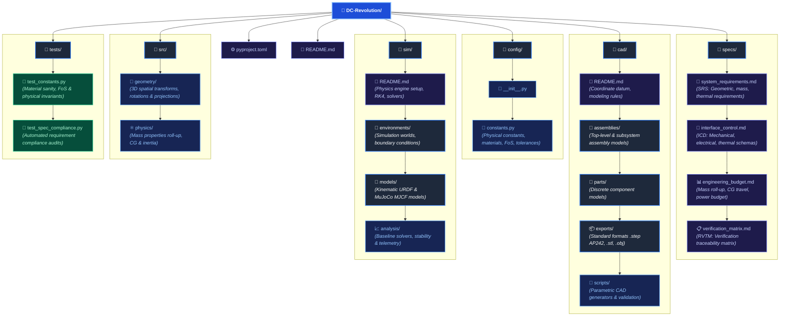

# DC-Revolution

Autonomous Cyber-Physical Platform Engineering: Specifications, Parametric CAD Synthesis, and Multi-Physics Simulation.

---

## 1. Executive Summary
**DC-Revolution** establishes an end-to-end aerospace/robotics engineering platform designed with rigorous mechanical specifications, zero-hardcoding architectural discipline, parametric CAD models, and high-fidelity physics simulations.

---

## 2. Directory Layout & Architecture



---

## 3. Engineering Specifications & Key Invariants
All design parameters and test assertions are anchored in [config/constants.py](file:///c:/SAGAR/MyProjectRepos/Industrial CPS Benchmark/DC-Revolution/config/constants.py):
- **Datum Coordinate Frame:** ISO 1151 Right-Handed Cartesian (+X Aft/Longitudinal, +Y Starboard/Right, +Z Upward).
- **Max Gross Mass:** 45.000 kg (with a minimum 15% unallocated mass contingency on dry structure).
- **Allowable CG Envelope:** $0.500\text{ m} \le X_{CG} \le 0.650\text{ m}$, $|Y_{CG}| \le 0.025\text{ m}$, $0.120\text{ m} \le Z_{CG} \le 0.200\text{ m}$.
- **Structural Safety Factors:** $\text{FoS}_{yield} \ge 1.25$, $\text{FoS}_{ult} \ge 1.50$.
- **Simulation Time Step:** $\Delta t = 0.001\text{ s}$ (1 kHz) with energy drift $< 0.01\%$/min.

---

## 4. Quick Start & Verification

### 4.1 Running the Automated Compliance Suite
Run the full test suite locally using `pytest`:
```bash
pytest tests/ -v
```

### 4.2 Generating Parametric CAD Manifest
```bash
python cad/scripts/generate_parametric_model.py
```

### 4.3 Running Dynamic Baseline Simulation
```bash
python sim/analysis/run_baseline_sim.py
```

---

## 5. Specification Documents
- [System Requirements Specification (SRS)](file:///c:/SAGAR/MyProjectRepos/Industrial CPS Benchmark/DC-Revolution/specs/system_requirements.md)
- [Interface Control Document (ICD)](file:///c:/SAGAR/MyProjectRepos/Industrial CPS Benchmark/DC-Revolution/specs/interface_control.md)
- [Engineering Mass & Power Budget](file:///c:/SAGAR/MyProjectRepos/Industrial CPS Benchmark/DC-Revolution/specs/engineering_budget.md)
- [Requirements Verification Traceability Matrix (RVTM)](file:///c:/SAGAR/MyProjectRepos/Industrial CPS Benchmark/DC-Revolution/specs/verification_matrix.md)
